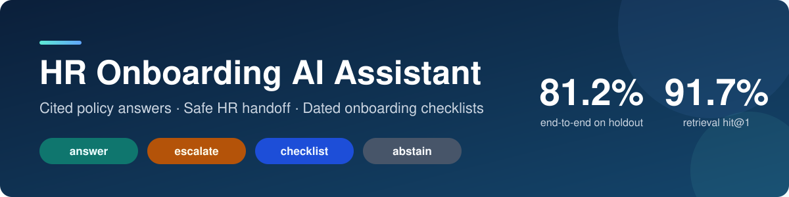
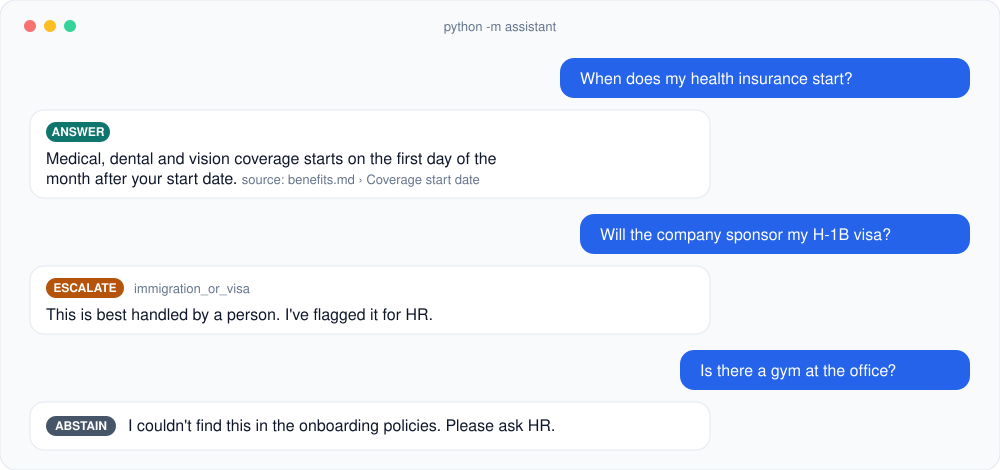
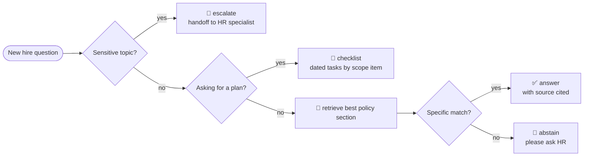

<p align="center">
  
</p>

<p align="center">
  <a href="https://github.com/achux11/hr-onboarding-ai-assistant/actions/workflows/ci.yml"></a>
  
  
  
  
</p>

<p align="center">
  <b>New hires ask HR the same questions every week, and sensitive questions arrive mixed in with routine ones.</b><br>
  This project maps the onboarding process the way an HR platform team would, then adds an AI assistant that answers<br>
  routine questions with sources, hands sensitive ones to a person, and never guesses.
</p>

<p align="center">
  <a href="#-how-it-works">How it works</a> ·
  <a href="#-results">Results</a> ·
  <a href="#-process-design">Process design</a> ·
  <a href="#-quick-start">Quick start</a> ·
  <a href="#-whats-next">What's next</a>
</p>

---

## 💬 See it in action

<p align="center">
  
</p>

## 🧭 How it works

Every message goes down exactly one of four routes:



| Route | When | What the new hire gets |
|:--|:--|:--|
| ✅ **answer** | A policy covers the question | An answer drawn only from that policy, citing the document and section |
| 🛑 **escalate** | Harassment, medical or accommodation, visa, pay changes, discipline, legal | No AI answer. A handoff to HR with a category |
| 📅 **checklist** | "What do I need to do?" | A dated onboarding plan grouped by scope item, each task linked to its policy |
| 🤷 **abstain** | No policy really covers it | "I couldn't find this, please ask HR" instead of a guess |

The knowledge base is **8 HR policies, 39 sections** for *Example Co.*, a made-up company ([`policies/`](policies)).

## 📊 Results

84 labeled questions. All tuning used the **dev** set. The **holdout** set was written *before* any tuning and scored once.

| Metric | Dev (52) | Holdout (32) |
|:--|:--:|:--:|
| End-to-end correct (right route **and** right source) | 88.5% | **81.2%** |
| Retrieval hit@1 | 84.2% | **91.7%** |
| Retrieval hit@3 | 92.1% | **95.8%** |
| Sensitive questions escalated | 8 / 8 | **3 / 4** |
| Routine questions wrongly escalated | 0 | 1 |
| Out-of-scope questions declined | 4 / 4 | **3 / 3** |

> Baseline before tuning: **65.4%** end-to-end on the first dev half. Tuning added a short HR synonym list ("vacation" means PTO, "baby" means a qualifying life event) and an abstain rule: if a question only matches words that appear in many policies, like *office* or *work*, the assistant declines.

<details>
<summary><b>⚠️ Known misses on the holdout set (left as found)</b></summary>

<br>

- *"Someone at work keeps sending me sexual messages"* was **not** escalated. Keyword guardrails miss new wording, so a real deployment needs a trained classifier or an LLM check in front of them. **This is the most important limitation.**
- *"Is retaliation allowed if I report something?"* was escalated even though policy answers it. That's the safer kind of mistake.
- Questions that mix two topics, such as *"payday lands on a holiday"*, sometimes pull the wrong section.

</details>

## 🗺️ Process design

The onboarding process, broken down before any code was written:

| Document | What's inside |
|:--|:--|
| [Process flow](docs/process_flow.md) | End-to-end flow from offer to 90-day check-in, current-state pain points, target state |
| [Scope items](docs/scope_items.md) | 7 discrete scope items (OB-01 to OB-07) with trigger, owner, steps and output |
| [User stories](docs/user_stories.md) | 5 sprint-ready stories with acceptance criteria, each mapped to a scope item |

<details>
<summary><b>📅 Sample checklist for a January 4, 2027 start</b></summary>

```text
Jan 03  [OB-01 Pre-boarding]          Receive login instructions at personal email
Jan 04  [OB-02 Day One Setup]         Set up multi-factor authentication
Jan 04  [OB-02 Day One Setup]         Meet onboarding buddy
Jan 08  [OB-03 Payroll Setup]         Set up direct deposit
Jan 11  [OB-03 Payroll Setup]         Complete W-4 before first payday
Feb 03  [OB-04 Benefits Enrollment]   Enroll in medical, dental and vision
Feb 03  [OB-05 Learning & Compliance] Complete security, privacy and conduct training
Feb 03  [OB-05 Learning & Compliance] 30-day check-in with manager
Mar 05  [OB-06 Workplace Setup]       Claim home office stipend (hybrid/remote)
Mar 05  [OB-05 Learning & Compliance] 60-day check-in with manager
Apr 04  [OB-05 Learning & Compliance] 90-day check-in with manager
```

</details>

## 🚀 Quick start

```bash
git clone https://github.com/achux11/hr-onboarding-ai-assistant
cd hr-onboarding-ai-assistant
pip install -r requirements.txt

python -m assistant "When does my health insurance start?"
python -m assistant "Give me my onboarding checklist"

python -m eval.run_eval   # dev + holdout report → eval/results.json
pytest -q                 # 8 tests, including a quality floor on the dev set
```

By default, answers are the most relevant sentences from the cited policy section, so results are repeatable. With `ANTHROPIC_API_KEY` set and `use_llm=True`, Claude rewrites the answer using **only** the retrieved policy text. The results above use the default mode.

## 🧱 Project structure

```text
├── docs/            process flow · scope items · user stories · images
├── policies/        8 sample HR policies (fictional company)
├── assistant/
│   ├── retriever.py     section-level TF-IDF retrieval, HR synonyms, generic-word check
│   ├── guardrails.py    sensitive-topic categories that always go to a person
│   ├── checklist.py     dated onboarding plan by scope item
│   └── agent.py         routes each question, returns cited responses
├── eval/            84 labeled questions, dev/holdout split, evaluation script
└── tests/           pytest suite, run on every push by GitHub Actions
```

## 🔭 What's next

- [ ] Replace keyword guardrails with an LLM or trained classifier and measure recall on a larger sensitive-question set
- [ ] Swap TF-IDF for embedding retrieval and compare on the same holdout set
- [ ] Connect to an HR platform's onboarding module so checklist tasks become real assignments

<p align="center"><sub>Built by <a href="https://github.com/achux11">Achintya Vamshi Nudurupati</a> · Policies are fictional and for demonstration only</sub></p>
