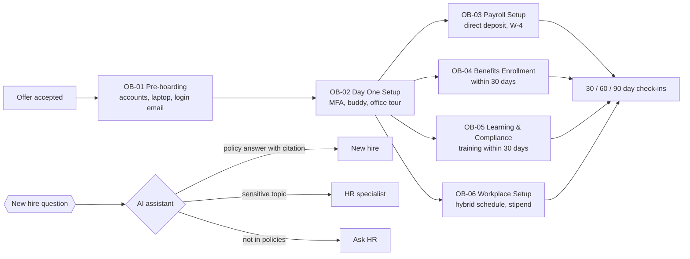

# Onboarding Process Flow

End-to-end new-hire onboarding at Example Co., from signed offer to the 90-day check-in, with the points where the AI assistant helps and where a person stays in charge.

## Current state pain points

| # | Pain point | Effect |
|---|---|---|
| 1 | New hires email HR the same questions: PTO, first paycheck, benefits deadline | HR spends time on repeat questions |
| 2 | Deadlines live in different policies (benefits 30 days, training 30 days, stipend 60 days) | Missed deadlines, such as losing the benefits window |
| 3 | No single onboarding plan per person | Managers and new hires track tasks by memory |
| 4 | Sensitive questions arrive mixed with routine ones | Risk of a generic answer to a harassment or medical question |

## Target state

- Routine policy questions are answered at once, with the exact policy section cited.
- Every new hire gets a dated checklist grouped by scope item.
- Sensitive topics never get an AI answer. They go to an HR specialist with a category.
- If no policy covers the question, the assistant says so instead of guessing.
